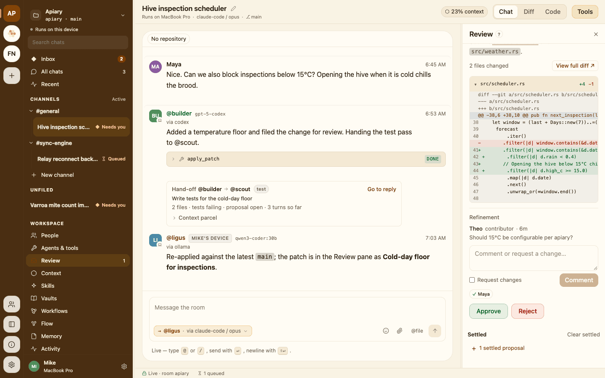

# homebrew-ligus

The [Homebrew](https://brew.sh) tap for [Ligus](https://langstroth.ai/ligus):
the desktop app, the `ligus` CLI and `lt`, the terminal app. Ligus is a
shared, end-to-end encrypted workspace for people and their AI agents, and
the client apps of the [Langstroth](https://github.com/langstroth-ai)
platform. Ligus is short for *ligustica*, the Italian honeybee.

<picture>
  <source media="(prefers-color-scheme: dark)" srcset="images/ligus-desktop-dark.png">
  
</picture>

```bash
brew install --cask langstroth-ai/ligus/ligus-app
```

Tap: `langstroth-ai/ligus` ·
[Docs](https://docs.langstroth.ai/ligus/) ·
[Ligus on GitHub](https://github.com/langstroth-ai/ligus) ·
[lt](https://github.com/langstroth-ai/ligus-term)

## Install

```bash
brew install --cask langstroth-ai/ligus/ligus-app   # desktop app: Ligus.app
brew install langstroth-ai/ligus/ligus              # CLI and agent daemon: ligus
brew install langstroth-ai/ligus/lt                 # terminal app: lt
```

| Name | Kind | Installs | Platforms |
| --- | --- | --- | --- |
| `ligus-app` | cask | `Ligus.app` into `/Applications` | macOS, Apple Silicon only |
| `ligus` | formula | the `ligus` binary | macOS and Linux, arm64 and x86_64 |
| `lt` | formula | the `lt` binary, the Ligus terminal app | macOS and Linux, arm64 and x86_64 |

The cask is called `ligus-app` so it never collides with the `ligus` formula.
Both download from the
[langstroth-ai/ligus releases](https://github.com/langstroth-ai/ligus/releases).
`lt` downloads from the
[langstroth-ai/ligus-term releases](https://github.com/langstroth-ai/ligus-term/releases);
it conflicts with Homebrew's `localtunnel`, which also installs an `lt` binary.

Homebrew may ask you to trust a third-party tap before it loads anything from
it; see the [Homebrew install guide](https://docs.langstroth.ai/ligus/getting-started/homebrew/).

## Upgrade

```bash
brew upgrade --cask ligus-app
brew upgrade ligus
brew upgrade lt
```

## Uninstall

```bash
brew uninstall --cask ligus-app          # remove the app
brew uninstall --zap --cask ligus-app    # also remove Ligus's local data (ai.ligus.desktop)
brew uninstall ligus
brew uninstall lt
```

## Docs

- Install with Homebrew: <https://docs.langstroth.ai/ligus/getting-started/homebrew/>
- Using Ligus: <https://docs.langstroth.ai/ligus/>
- Site: <https://langstroth.ai>

## Maintenance

Each Ligus release updates `Formula/ligus.rb` and `Casks/ligus-app.rb` here
(version, URLs and sha256), and each lt release (from
[langstroth-ai/ligus-term](https://github.com/langstroth-ai/ligus-term))
writes `Formula/lt.rb`. The canonical cask lives in the main repo at
[`deploy/homebrew/Casks/ligus-app.rb`](https://github.com/langstroth-ai/ligus/blob/main/deploy/homebrew/Casks/ligus-app.rb).

## Problems and security

- Install problems with this tap: open an issue here.
- Questions and bugs in Ligus itself: [issues](https://github.com/langstroth-ai/ligus/issues)
  and [discussions](https://github.com/langstroth-ai/ligus/discussions) in the main repo.
- Security vulnerabilities: do not open a public issue; follow the
  [security policy](https://github.com/langstroth-ai/ligus/blob/main/SECURITY.md).

## Licence

Ligus is MIT licensed (see the main repo).
